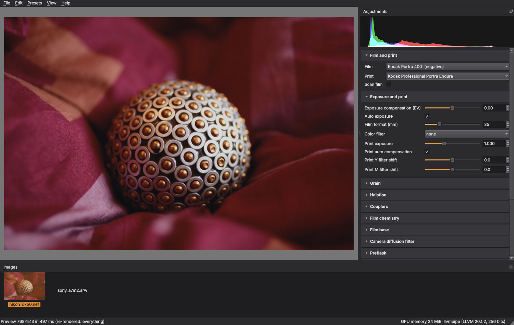

# Spectra (working title)

A native, GPU-accelerated film simulation app for Windows, built as a faithful port of
[spektrafilm](https://github.com/andreavolpato/spektrafilm) by Andrea Volpato.
Film simulation powered by spektrafilm profiles (CC BY-SA 4.0).



It simulates the whole analogue chain spectrally: exposure of the film, development with DIR
couplers, grain, halation, printing through an enlarger onto paper, and scanning. The model,
its equations and its parameters are spektrafilm's; this project re-implements them in C++ with
a Vulkan compute backend and checks the result against the Python reference
(1,270 parity cases on the CPU, the same suites on the GPU path).

**Status:** all six phases are implemented. The GPU path has so far only run on a software
Vulkan renderer; the numbers on real hardware are still to come. See `PROGRESS.md` for what is
verified and what is not.

## Install (Windows 10 / 11, 64-bit)

1. Open the repository's **Actions** tab on GitHub, pick the latest successful `ci` run of the
   branch, and download the artifact **spectra-app-windows-installer**.
2. Unzip it and run `spectra-app-<version>-Windows-AMD64.exe`. Windows SmartScreen will warn
   that the installer is unsigned; choose "More info", then "Run anyway".
   The `.zip` next to it is the same program as a portable folder: unzip and run
   `bin\spectra-app.exe`.
3. Use a current graphics driver. Any GPU with Vulkan 1.1 works (Intel, AMD, NVIDIA). Without a
   Vulkan device the app still runs, on the CPU, slowly.

On first start the app measures the GPU for a few seconds and chooses the preview size and
batching for it. You can repeat this under Edit > Settings > "Re-run performance calibration".

## Using the app

- **Open** camera RAW files (anything LibRaw reads), TIFF, PNG, JPEG or EXR: File > Open, or
  drop them on the window. A RAW file shows a fast preview first while the full decode runs.
- **Film and print**: choose a film stock and a print paper. Choosing a film loads that
  stock's grain, halation and coupler settings; your other adjustments are kept. Slide films
  are scanned directly ("Scan film").
- **Adjustments** are spektrafilm's own parameters, with its labels, ranges and tooltips.
  View > "Advanced parameters" shows all of them. Double-click a parameter's name to reset it.
- **Preview**: double-click the image (or press Z) for 100 %, drag to pan; `\` shows the
  unprocessed original. While a slider moves you see a quick low-resolution pass that is then
  refined.
- **Export**: File > Export (TIFF 8 / 16 / 32-bit float, PNG, JPEG, EXR), "Export all images"
  for a batch, "Export LUT" for a `.cube` file of the colour and tone (no grain or halation,
  which a LUT cannot hold).
- **Presets**: the Presets menu has film / print pairings and your own saved presets.
- **Extended** section: push / pull, bleach bypass and HDR export. These are additions adapted
  from spektrafilm-ofx; they are not part of spektrafilm, are off by default, and are not
  covered by the parity tests.
- Images larger than the GPU memory budget are rendered in tiles automatically. The diffusion
  filter cannot be used on tiled renders in this version; the app says so before exporting.

## Build from source

Requirements: CMake 3.24+, a C++20 compiler (MSVC 2022, GCC 13 or Clang 18), Git (LibRaw 0.22.0
is fetched at configure time), Qt 6.4+ for the desktop app.

### Windows

`docs/WINDOWS_SETUP.md` lists exactly what to install. Then, from a "Developer PowerShell for
VS 2022" in the repository folder, one script builds everything, runs every test on your GPU,
benchmarks it and writes a report:

```powershell
.\scripts\run_local_checks.ps1 -InstallQt
```

To build by hand instead (replace the Qt path with yours):

```powershell
cmake -S . -B build -DCMAKE_TOOLCHAIN_FILE="$env:VCPKG_ROOT\scripts\buildsystems\vcpkg.cmake" -DVCPKG_TARGET_TRIPLET=x64-windows -DCMAKE_PREFIX_PATH=C:\Qt\6.8.3\msvc2022_64
```

```powershell
cmake --build build --config Release --parallel
```

```powershell
ctest --test-dir build -C Release -LE memory --output-on-failure
```

The installer and the portable zip (needs [NSIS](https://nsis.sourceforge.io) on `PATH`):

```powershell
cd build; cpack -C Release -G "NSIS;ZIP"
```

### Linux (Ubuntu 24.04)

```bash
sudo apt-get install -y cmake ninja-build g++ git libtiff-dev libpng-dev libjpeg-turbo8-dev libopenexr-dev zlib1g-dev libvulkan-dev mesa-vulkan-drivers glslc qt6-base-dev
```

```bash
cmake -S . -B build -G Ninja -DCMAKE_BUILD_TYPE=Release
```

```bash
cmake --build build --parallel
```

```bash
ctest --test-dir build -LE memory --output-on-failure
```

```bash
build/spectra-app
```

Missing pieces switch features off with a warning instead of failing: no Qt means no desktop
app, no Vulkan means no GPU backend, no image libraries means no file I/O. Building and testing
needs no Python: the data pack, the goldens and the compiled shaders are in the repository.

## Command-line tool

```bash
build/spectra-cli info
```

```bash
build/spectra-cli render --in photo.CR3 --out photo.tif --film kodak_portra_400 --print kodak_portra_endura --backend gpu
```

```bash
build/spectra-cli batch --out-dir out --format tif --film kodak_gold_200 --print kodak_ektacolor_edge a.CR3 b.NEF
```

```bash
build/spectra-cli lut --out portra400.cube --size 33 --input acescct
```

```bash
build/spectra-cli calibrate
```

```bash
build/spectra-cli bench-preview --in photo.CR3
```

```bash
build/spectra-cli bench --backend gpu --mp 20,30
```

```bash
build/spectra-cli parity tests/golden/t2_nonspatial/cases.json --backend gpu -v
```

`render` reproduces the Python reference exactly (it is what the parity tests use); `batch`,
`lut` and the app go through the same engine as the desktop app. RAW test files are fetched with
`python scripts/fetch_test_raws.py` (sources and licences in `test_data/SOURCES.md`).

## Changing the product name

The name is one value: `SPECTRA_PRODUCT_NAME` near the top of `CMakeLists.txt`. The window
title, About dialog, installer, Start-menu entry and the header of exported LUTs follow it.

## Documents

- `PROGRESS.md`: status, results, decisions, open issues, what is unverified on real hardware.
- `DEVIATIONS.md`: every place this port knowingly differs from, or had to interpret, the reference.
- `ARCHITECTURE.md`, `FEATURE_MATRIX.md`, `RISKS.md`, `LICENSES.md`: research and design.
- `docs/WINDOWS_SETUP.md`: what to install on Windows and how to run the local GPU checks.
- `tools/exporter/README.md`: regenerating the data pack, the goldens and the GUI manifest.

## Licence

Code: GPL-3.0-or-later (`LICENSE`). Profile data: CC BY-SA 4.0
(`data/SPEKTRAFILM_LICENSE.txt`). Third-party software: `THIRD_PARTY_NOTICES.md`.
This project is not affiliated with or endorsed by the spektrafilm project.
